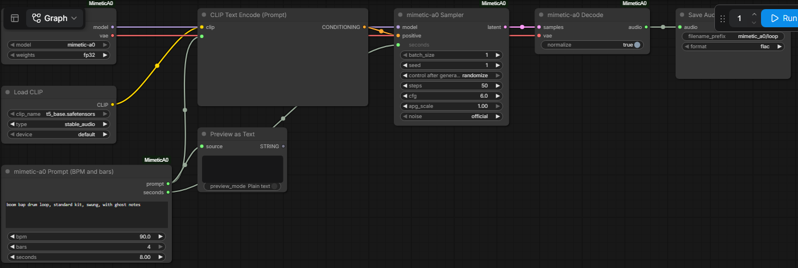

# mimetic-a0 for ComfyUI

[日本語](README.ja.md)

Text to music with [mimetic-a0](https://huggingface.co/micknoisemachine/mimetic-a0) (Mick Grierson, MIT), a model trained only on audio
with a clean licence: Freesound clips released as CC0 and synthetic music from the author's own generators. It writes 48 kHz stereo,
up to 16 s: drum loops, basslines, chords, melodies, pads, one-shots and full mixes, at the tempo, key and chords you ask for.

The pack runs the model on ComfyUI's own stable-audio classes (DiT, autoencoder, T5-base text encoder) and samples it the way the
official tools do. It needs no Python packages beyond ComfyUI's, and nothing is downloaded while a workflow runs.

This is an unofficial integration, not affiliated with the model's author, Stability AI or Comfy Org.

## Nodes

| Node | What it does |
| --- | --- |
| **mimetic-a0 Loader** | Loads `models/mimetic_a0/<name>/` (fp32 2 GB, or fp16 1 GB) and gives a MODEL and a VAE. |
| **mimetic-a0 Prompt (BPM and bars)** | The command line's `--bpm` / `--bars`: adds "90 BPM, 4 bars" to the prompt if it is missing and sets the length to exactly that many bars of 4/4. |
| **mimetic-a0 Sampler** | The official sampler: the length plus 6 s of headroom, the official starting noise, 50 Euler steps spaced evenly in log-SNR, CFG 6 against the zeroed prompt with adaptive projected guidance. Several takes in one batch. |
| **mimetic-a0 Decode** | Decodes each take and trims it to the length. By default each take peaks at -1 dBFS, like the command line's WAV files. |

The prompt goes through the core **Load CLIP** node with `t5_base.safetensors`, type `stable_audio`, and **CLIP Text Encode**.



## Install

From the ComfyUI Manager or the Comfy Registry (`mimetic-a0-music`), or:

```bash
cd ComfyUI/custom_nodes
git clone https://github.com/hiroki-abe-58/ComfyUI-MimeticA0
```

Then the model files (pinned revisions, every file checked against its SHA-256):

```bash
python custom_nodes/ComfyUI-MimeticA0/tools/download_model.py --models-dir models            # fp32 weights + T5-base, 2.9 GB
python custom_nodes/ComfyUI-MimeticA0/tools/download_model.py --models-dir models --weights all   # also the fp16 weights
```

This gives `models/mimetic_a0/mimetic-a0/` (model_config.json, the weights, the release's LICENSE, NOTICE, README and PROMPTING.md)
and `models/text_encoders/t5_base.safetensors`, the T5-base file that ComfyUI's Stable Audio workflows use; if you already have a
`t5_base.safetensors`, it is kept. Restart ComfyUI and open a workflow from `workflows/gui/`:

- `text_to_music.json`: a boom bap loop at 90 BPM, 4 bars (10.7 s), one take.
- `four_takes.json`: four takes of a single cello note with the fp16 weights.

## Prompting

The model follows the wording of its training captions best; `PROMPTING.md` in the model folder lists every instrument, style and
clause it knows. A prompt is what it is, then the music, then tempo, key and length:

```
hip hop drum loop, standard kit, swung, with ghost notes, 90 BPM, 4 bars
finger bass bassline, over Cm - Fm - G7, sparse, 95 BPM, C minor, 4 bars
electric piano chords, chords Am7 - D9 - Gmaj7, smooth, sustained, 100 BPM, G major, 2 bars
808 kit snare hit, one-shot, hard
single cello note, G3
```

Set the length to the bars you ask for (the Prompt node does it). 50 steps and CFG 6 are what the model was tested with. Results
vary by seed, so ask for several takes. From the model's README: music first (SFX and field recordings are weak), 4/4 only, 1, 2 or
4 bars, at most 16 s; most instruments sound like General MIDI samples, and the autoencoder limits the top octave and noise textures.

## Same as the official tools?

Checked against the official code (mimetic-a0 9f91b67 on stable-audio-tools 3241adb, torch 2.7.1) on an RTX 5090, seven cases: see
[docs/VERIFICATION.md](docs/VERIFICATION.md).

- **The model, sampler and decoder**: given the same text embedding, the pack's fp32 takes match the official ones to 95–116 dB
  (largest difference 3e-5 of full scale): the rounding of two different PyTorch builds. The starting noise, the schedule and the
  conditioning are bit-identical.
- **The text encoder**: ComfyUI computes T5-base in fp32, the official code in fp16. The embeddings differ by 49–59 dB, and through
  50 guided steps that gives takes that are 32–89 dB from the official ones: the same music with small differences. The official
  fp16 embedding is not stable itself: the same official recipe with transformers 5.20.1 instead of 4.57.6 is 56 dB away. The
  official code cuts prompts at 128 T5 tokens; ComfyUI's T5-base does not, so a longer prompt is conditioned differently (the
  prompts of the model's guide are far shorter).
- **fp16 weights**: the official code also keeps the sampler's state in fp16, ComfyUI in fp32; the takes are 36 dB apart. The
  official fp16 and fp32 takes of one seed are 19 dB apart, so a seed gives a different take with fp16, as the model's README says.
- **Precision**: the official sampler turns TF32 off. With PyTorch's default (TF32 for cuDNN convolutions) the latents were 61–64 dB
  from the official ones instead of 110–115 dB, so the Sampler and Decode nodes turn it off while they run and restore ComfyUI's
  setting afterwards.
- **Seeds**: `noise = official` draws the starting noise on the sampling device as the official code does; `cpu` draws it on the CPU,
  the same on every machine.

On an RTX 5090 a 10.7 s take takes 1.6 s through the ComfyUI queue (3.2 s for the first run, which loads the model); PyTorch
allocated at most 3.8 GB of VRAM with the fp32 weights and T5-base loaded. The CPU works too, slowly.

## Licence

The pack's code is MIT ([LICENSE](LICENSE)). The model is MIT, T5-base Apache-2.0; see [NOTICE](NOTICE) for the training data
credits from the model's NOTICE, including the GeneralUser GS SoundFont, whose author notes that the origin of some of its samples is
uncertain.
